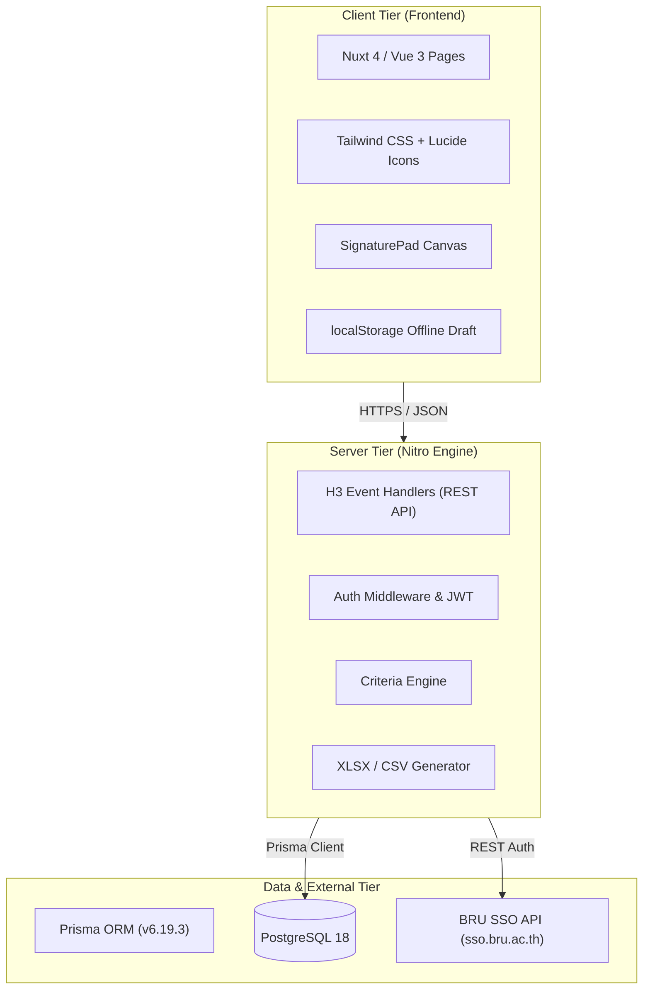

# บทที่ 1: ภาพรวมสถาปัตยกรรมและเทคโนโลยี (Architecture & Tech Stack)

## 1. ภาพรวมของระบบ (System Overview)

ระบบประเมินผลการปฏิบัติงานบุคลากรประจำอาคาร (แม่บ้าน) มหาวิทยาลัยราชภัฏบุรีรัมย์ พัฒนาขึ้นในรูปแบบ **Full-stack Single-Page/Progressive Web Application (PWA)** เพื่อรองรับการทำงานของคณะกรรมการตรวจประเมินอาคารผ่านแท็บเล็ตและสมาร์ตโฟน (Mobile-First) โดยมีเป้าหมายหลักคือ:
1. การตรวจประเมินตามเกณฑ์มาตรฐาน 7 หมวด 35 ข้อคำถาม
2. รองรับการลงชื่อดิจิทัล (Digital Signature Canvas) และแนบรูปภาพข้อบกพร่อง
3. คำนวณคะแนนและเกรดประเมินแบบเรียลไทม์
4. รองรับคณะกรรมการหลายท่านตรวจอาคารเดียวกันในรอบเดียวกัน โดยเฉลี่ยคะแนนระดับรายข้อ (Multi-Auditor Item-Level Consensus)
5. สรุปผล วิเคราะห์ความเสี่ยง และส่งออกไฟล์รายงาน Excel สำหรับฝ่ายบริหาร

---

## 2. สแต็กเทคโนโลยี (Technology Stack)



| เลเยอร์ | เทคโนโลยี | รายละเอียด |
| :--- | :--- | :--- |
| **Frontend Framework** | **Nuxt 4.6.2** (Vue 3.5) | ใช้สถาปัตยกรรม Composition API (`<script setup lang="ts">`) และ Nuxt Auto-imports |
| **CSS & Design** | **Tailwind CSS 3** | Utility-first CSS ดีไซน์ Responsive สไตล์มินิมอล รองรับจอสัมผัส |
| **Icons & Media** | **lucide-vue-next** | ไอคอน SVG คมชัด โหลดเร็ว |
| **Utility Libraries** | **@vueuse/core** | สำหรับ Reactive Web APIs เช่น การตรวจสถานะออฟไลน์/ออนไลน์ |
| **Server Engine** | **Nitro (h3)** | เอนจินเซิร์ฟเวอร์แบบเบา ประสิทธิภาพสูง รองรับทั้ง Node.js, Serverless, Docker |
| **Database ORM** | **Prisma ORM 6.19.3** | Type-safe ORM พร้อมเครื่องมือ Prisma Client, Migrations และ DB Seed |
| **Database** | **PostgreSQL 18** | Relational Database มาตรฐานความเสถียรสูง รองรับ JSONB, Cascades, Constraints |
| **Authentication** | **BRU SSO API** | ยืนยันตัวตนบุคลากรผ่าน Web Service มหาวิทยาลัยราชภัฏบุรีรัมย์ |

---

## 3. โครงสร้างไดเรกทอรีโครงการ (Project Directory Structure)

```
D:\git\FQ
├── assets/                  # ไฟล์ Static Assets เช่น CSS (tailwind.css)
├── components/              # Vue Reusable Components
│   ├── Navbar.vue           # แถบนำทางด้านบน รองรับเมนูและการแสดงสถานะล็อกอิน
│   ├── QuestionCard.vue     # การ์ดแสดงข้อคำถาม การให้คะแนน 1-5 และปุ่ม N/A
│   ├── ScoreSummaryBar.vue  # แถบสรุปผลคะแนนแบบเรียลไทม์ติดขอบล่างของจอ
│   └── SignaturePad.vue     # คอมโพเนนต์วาดลายเซ็นดิจิทัลผ่าน HTML5 Canvas
├── middleware/              # Nuxt Route Middlewares
│   └── auth.global.ts       # Global Auth Guard ตรวจสอบสิทธิ์การเข้าถึงหน้าเว็บ
├── pages/                   # หน้าจอหลักของระบบ (File-based Routing)
│   ├── index.vue            # หน้าแรก / Dashboard สรุปภาพรวมอาคารที่ต้องตรวจ
│   ├── login.vue            # หน้าจอลงชื่อเข้าใช้งาน (BRU SSO & Admin)
│   ├── evaluate/index.vue   # แบบฟอร์มตรวจประเมิน 7 หมวด 35 ข้อ
│   ├── reports/index.vue    # หน้ารายงานสรุปคะแนน แนวโน้ม และจุดบกพร่อง
│   └── admin/index.vue      # แผงควบคุมระบบ (รอบประเมิน, อาคาร, กรรมการ, เกณฑ์คะแนน)
├── prisma/                  # การจัดการฐานข้อมูล
│   ├── schema.prisma        # โครงสร้าง Data Models ของ PostgreSQL
│   ├── seed.ts              # สคริปต์ลงข้อมูลเริ่มต้น (Categories, Questions, Users, Buildings)
│   ├── migrate-data.ts      # สคริปต์โอนข้อมูลจาก SQLite มายัง PostgreSQL
│   └── dev.db               # ฐานข้อมูล SQLite สำรองเดิม
├── public/                  # ไฟล์ Static สาธารณะ (โลโก้, favicon)
├── server/                  # Backend Server (Nitro Engine)
│   ├── api/                 # REST API Endpoints แบ่งตามโดเมน
│   │   ├── assessments/     # บันทึกและดึงข้อมูลผลการตรวจประเมิน
│   │   ├── auth/            # ตรวจสอบการเข้าสู่ระบบ
│   │   ├── buildings/       # จัดการอาคารและบุคลากรประจำอาคาร
│   │   ├── questions/       # จัดการหมวดและข้อคำถาม
│   │   ├── reports/         # คำนวณสรุปคะแนนและ Export Excel
│   │   ├── rounds/          # จัดการรอบการประเมิน
│   │   ├── settings/        # จัดการเกณฑ์ตัดเกรด/สีคะแนน
│   │   ├── sso/             # ค้นหาบุคลากรผ่าน BRU SSO
│   │   └── users/           # จัดการผู้ใช้งานและบทบาท
│   └── utils/               # ฟังก์ชันช่วยเหลือฝั่ง Server
│       ├── dbState.ts       # ตรวจสอบสถานะการเชื่อมต่อ PostgreSQL + Cache
│       ├── prisma.ts        # Prisma Client Instance (Singleton Pool)
│       └── settings.ts      # ตรรกะเกณฑ์คะแนนและการตัดเกรด
├── shared/                  # โค้ดและ Type Definitions ที่ใช้ร่วมกันทั้งหน้า-หลังบ้าน
│   ├── constants/           # ค่าคงที่ เช่น ข้อคำถามมาตรฐาน
│   └── types/               # TypeScript Interfaces (Evaluation, Criteria, User)
├── Manual/                  # เอกสารคู่มือนักพัฒนา (เอกสารชุดนี้)
├── .env                     # ตัวแปรสภาพแวดล้อม (DATABASE_URL, SSO Secret)
├── nuxt.config.ts           # การตั้งค่า Nuxt, Tailwind และ Modules
└── package.json             # รายการ Dependencies และ NPM Scripts
```

---

## 4. วงจรการทำงานหลักของระบบ (Core Workflows)

### 4.1 ขั้นตอนการเข้าสู่ระบบ (Authentication Flow)
1. ผู้ใช้เข้าหน้าจอใดก็ตาม ระบบจะถูกตรวจโดย `middleware/auth.global.ts`
2. หากยังไม่พบคุกกี้ `auth_token` หรือ `user_session` จะเปลี่ยนเส้นทางไปยัง `/login`
3. ผู้ใช้กรอก Username / Password:
   - บัญชี `admin` / `admin`: ล็อกอินผ่าน Local Mode สำหรับผู้ดูแลระบบ
   - บัญชีบุคลากร BRU: ตรวจสอบผ่าน `https://sso.bru.ac.th/api/v1/auth/login` แบบเรียลไทม์
4. เมื่อสำเร็จ บันทึก Cookie อายุ 7 วัน และนำทางไปยังหน้าหลัก (`/`)

### 4.2 วงจรการตรวจประเมิน (Assessment Lifecycle)
1. กรรมการเลือก **รอบการประเมิน** และ **อาคารที่ต้องการตรวจ**
2. ระบบจะโหลดรายชื่อแม่บ้านประจำอาคารและดึงแบบร่างจาก `localStorage` (ถ้ามี)
3. กรรมการให้คะแนนแต่ละข้อ (1 ถึง 5 หรือเลือก N/A กรณีไม่เกี่ยวข้อง)
4. กรอกสรุปจุดเด่นและจุดบกพร่องเร่งด่วน พร้อมแนบภาพถ่าย (ถ้ามี)
5. กรรมการลงชื่อดิจิทัลผ่าน Signature Pad
6. กด "ส่งผลการประเมิน" ข้อมูลจะถูกบันทึกลงใน PostgreSQL ผ่าน `/api/assessments` ทันที และเคลียร์แบบร่างในเครื่อง
