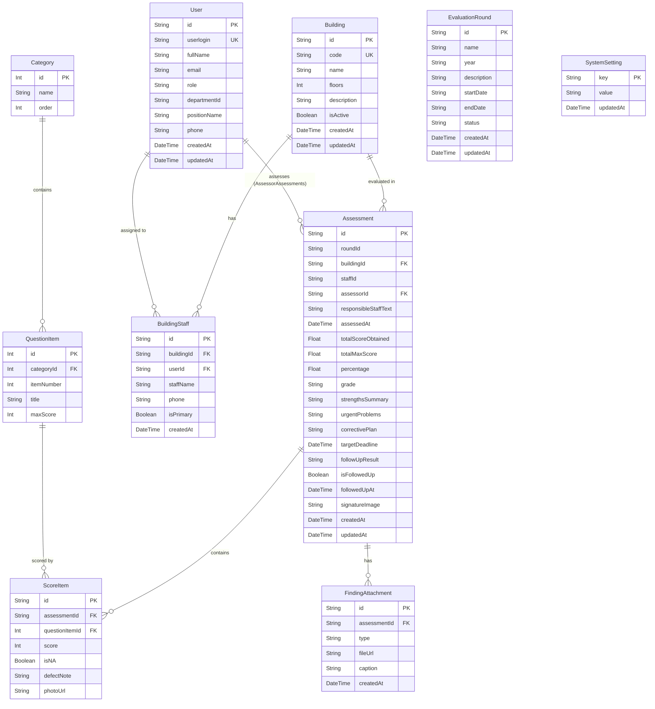

# บทที่ 2: โครงสร้างฐานข้อมูลและการจัดการ Schema (Database & Prisma ORM)

## 1. แบบจำลอง Entity-Relationship (ER Diagram)

ระบบใช้ฐานข้อมูลเชิงสัมพันธ์ **PostgreSQL** โดยมีการสร้างแบบจำลองข้อมูล (Schema) ผ่าน **Prisma ORM** ดังนี้:

---

## 2. รายละเอียด Data Models (Schema Specification)

### 2.1 Model: `User`
เก็บบัญชีผู้ใช้ที่ซิงก์มาจาก BRU SSO หรือสร้างขึ้นในระบบ
- `id` (UUID): Primary Key
- `userlogin` (String, Unique): Username จากระบบ BRU SSO
- `fullName` (String): ชื่อ-นามสกุล
- `role` (String): ระดับสิทธิ์ ได้แก่ `ADMIN`, `AUDITOR` (กรรมการ), `SUPERVISOR`, `HOUSEKEEPER` (แม่บ้าน)
- `departmentId`, `positionName`, `phone`: ข้อมูลสังกัดและตำแหน่ง

### 2.2 Model: `EvaluationRound`
รอบการประเมินผลแต่ละปีงบประมาณ
- `id` (UUID หรือ slug เช่น `round-2570`): รหัสรอบ
- `name` (String): ชื่อรอบ เช่น "รอบการประเมินประจำปีงบประมาณ 2570"
- `year` (String): ปี พ.ศ. เช่น "2570"
- `status` (String): สถานะ `OPEN` (เปิดรับผลประเมิน) หรือ `CLOSED` (ปิดรอบแล้ว)

### 2.3 Model: `Building` และ `BuildingStaff`
ข้อมูลอาคารและผู้รับผิดชอบประจำอาคาร
- **Building**: รหัสอาคาร (`code` เช่น "B15"), ชื่ออาคาร (`name`), จำนวนชั้น (`floors`), สถานะเปิดใช้งาน (`isActive`)
- **BuildingStaff**: เชื่อมโยงอาคารกับแม่บ้าน โดยเก็บชื่อ-สกุล (`staffName`), เบอร์ติดต่อ (`phone`), และเป็นแม่บ้านหลักหรือไม่ (`isPrimary`)

### 2.4 Model: `Category` และ `QuestionItem`
หมวดหมู่และข้อคำถามตรวจประเมิน
- **Category**: หมวดที่ 1 ถึง 7 ตามประกาศเกณฑ์ของมหาวิทยาลัย
- **QuestionItem**: ข้อคำถาม 1 ถึง 35 แต่ละข้อมีคะแนนเต็ม 5 คะแนน (`maxScore = 5`)

### 2.5 Model: `Assessment` และ `ScoreItem`
ผลการตรวจประเมินรายครั้ง
- **Assessment**: บันทึกการตรวจ 1 ใบ ต่อ 1 อาคาร ต่อ 1 กรรมการ
  - คำนวณคะแนนรวมที่ได้ (`totalScoreObtained`), คะแนนเต็มหักข้อ N/A (`totalMaxScore`), ร้อยละ (`percentage`), และเกรด (`grade`: EXCELLENT, GOOD, FAIR, IMPROVEMENT, URGENT_ACTION)
  - เก็บข้อค้นพบ: จุดเด่น (`strengthsSummary`), จุดบกพร่องเร่งด่วน (`urgentProblems`), แผนปรับปรุง (`correctivePlan`)
  - เก็บภาพลายเซ็นดิจิทัล Base64 Data URL (`signatureImage`)
- **ScoreItem**: คะแนนรายข้อ แต่ละใบประเมินจะมี 35 ระเบียน (Composite Unique: `assessmentId` + `questionItemId`)
  - บันทึกคะแนน `1-5` หรือ `null` เมื่อ `isNA = true`
  - บันทึกข้อบกพร่องเฉพาะข้อ (`defectNote`) และภาพประกอบ (`photoUrl`)

### 2.6 Model: `SystemSetting`
ตาราง Key-Value เก็บการตั้งค่าส่วนกลางในรูปแบบ JSON String
- `criteria_building`: การตั้งค่าช่วงคะแนนและสีแสดงผลสำหรับอาคาร (เขียว / เหลือง / แดง)
- `criteria_staff`: การตั้งค่าช่วงคะแนนและสีแสดงผลสำหรับการประเมินแม่บ้านรายบุคคล

---

## 3. คำสั่ง Prisma CLI และขั้นตอนการทำงาน

ในไฟล์ `package.json` มีการผูกคำสั่งอำนวยความสะดวกไว้ดังนี้:

| คำสั่ง | คำสั่งเต็ม | คำอธิบาย |
| :--- | :--- | :--- |
| `pnpm run db:generate` | `prisma generate` | อัปเดตและสร้าง Types ของ `@prisma/client` จาก `schema.prisma` |
| `pnpm run db:push` | `prisma db push` | ส่ง Schema ขึ้นไปซิงก์กับ PostgreSQL โดยตรง (สร้างตาราง/ดัชนีทันที) |
| `pnpm run db:seed` | `tsx prisma/seed.ts` | ลงข้อมูลเริ่มต้น เช่น 7 หมวด, 35 ข้อคำถาม, 5 อาคาร, ผู้ใช้ตัวอย่าง, และเกณฑ์คะแนน |
| `pnpm run db:migrate-data` | `tsx prisma/migrate-data.ts` | โอนย้ายข้อมูลเดิมทั้งหมดจากไฟล์ SQLite (`prisma/dev.db`) ไปยัง PostgreSQL |

---

## 4. การจัดการประสิทธิภาพการเชื่อมต่อ (Connection & Caching Strategy)

เนื่องจากสถาปัตยกรรมเดิมถูกออกแบบมาเพื่อ SQLite (Embedded 0ms) เมื่อเปลี่ยนมาใช้ PostgreSQL ผ่าน Network Socket จึงมีการปรับปรุงประสิทธิภาพใน [server/utils/dbState.ts](file:///d:/git/FQ/server/utils/dbState.ts) ดังนี้:

1. **IPv4 Loopback Direct Binding (`127.0.0.1`):**
   - เปลี่ยนจาก `localhost` เป็น `127.0.0.1` ใน `DATABASE_URL` เพื่อลดขั้นตอนการค้นหา DNS IPv6 (`::1`) บนระบบปฏิบัติการ Windows ลง 50ms
2. **Two-Tier Health Status Caching:**
   - **Success Cache (60 วินาที):** เมื่อเชื่อมต่อสำเร็จแล้ว ระบบจะจำสถานะไว้ 60 วินาที และอนุญาตให้ส่งคำสั่ง Query ของ API ได้ทันทีโดยไม่ต้องยิง `SELECT 1` ตรวจซ้ำซ้อน
   - **Failure Cache (10 วินาที):** หากฐานข้อมูลยังไม่เปิดทำงาน ระบบจะจำสถานะล้มเหลวไว้ 10 วินาที เพื่อสลับไปใช้ In-Memory Fallback ได้ทันทีที่ 0ms โดยไม่ต้องรอ Connection Timeout ซ้ำๆ ในทุก Request
